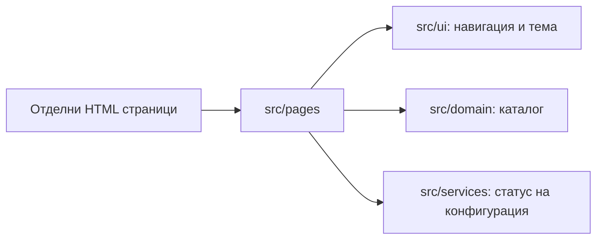

# Реализирана архитектура

HTML/CSS/чист JavaScript/Bootstrap, Node/npm/Vite. Отделни входове: `index.html`, `pages/dashboard.html`, `pages/buildings.html`; споделен ES module контролер зарежда навигация, тема, BG ресурси и каталог.

Тъмната тема използва Bootstrap `data-bs-theme` и `localStorage` ключ `propertyhub.theme` (само предпочитание, без лични данни). При забранен storage изборът работи в текущата страница. CSS tokens са в `src/styles/main.css`. Няма analytics.

Supabase DB/Auth/Storage е предстоящ backend, не действаща интеграция. Няма създадени таблици, SQL операции, роли, storage buckets или DB диаграма в тази версия. Клиентският каталог не е механизъм за права. Следващите миграции трябва да налагат grants/RLS и проверки независимо от UI.

`vite build` включва само изричните HTML входове и техните зависимости. Планиращият пакет е игнориран от Git; достъпът до него през dev сървъра е забранен. За hosting се използва само `dist/`. Development и preview се обвързват към loopback, не към LAN.
