# Реализирана архитектура

## Интеграция на main във финансовия клон, 06.11.2026

Актуалният main f8f39aa е интегриран със запазена история във финансовия клон.
Production остава на 9b98359; тази интеграция не е deployment. CALC-04 кодът и
неприложената му миграция са запазени. Месечната навигация използва вече разрешените
server scopes от draft/preview/charge проекциите и текущия server can_manage_registry;
не зарежда monthly rule/preview историята в header и не дава права от име на роля.
Реалният monthly service/RPC проверява отново достъпа при отваряне. P2 cutover е
приключен; CALC hosted/MVCC остава BLOCKED от октомврийския fixture, не става PASS
чрез Git merge. Няма промяна на SQL, финансови права, формули или write механизми.

## P5 CALC-04 — ограничен месечен TARIFF, локално приет, 05.11.2026

Typed domain/service/controller/UI/BG → guarded monthly adapters → съществуващи resolutions/rule versions/immutable previews и общ save/review/publish engine. Нов monthly_context_reviews пази explicit whole-month registry completeness source; новата категория е equal_units/TARIFF, без FND-F05 rounding/qualification. Snapshot/claim модел monthly-owner-occupant-v1, точни q/N×q и исторически parties; старите FND feeds са изолирани, публичните charge v2 подписи са запазени. Person contacts/raw registry evidence не се връщат в новия финансов DTO.

16 DB/domain/RLS +8 реални локални UI/service групи, 4 визуални mobile/desktop/две теми, offline ci/build/navigation PASS. Миграция 20261105131317_monthly_management_equal_tariff.sql е неприложена; hosted/MVCC не са доказани. [Договор, права, ограничения и бъдещ план](MONTHLY_MANAGEMENT.md).

## Междинен production release, 06.11.2026

**Production, 06.11.2026:** PR #10 е merge-нат със запазена история в
`9b9835990a540525ed87229fa4590e2e77d1ce4f`. Един automatic Netlify production deployment
`6aedeea5e28bf5fe312e1f85` е READY/published на 06.11.2026, 15:13:55 UTC.
Backend е потвърден с **38 приложени версии**; P2 `20261104212948` е приложена
еднократно. CALC-04 не е включен в този release и не е приложен.

Пред-CALC основата b47ad97 с PR8/P2 историята и UI/branding/help е публикувана чрез
PR #10. Registry/owner/ticket/attachments, P1, FND-F05, payments/accounts/inbound,
P4a funds и P4b expenses са включени. CALC код/миграция липсват от release tree.

Header discovery първо използва минималните guarded проекции и scoped draft feed;
допълнителните финансови feeds се извикват само за непокритите разрешени контексти.
Current role metadata е само hint за заявката; capability идва от server response.
Няма права от admin име, stale-role cache или промяна на финансовите write пътища.
Дългите workspace контексти са ограничени до ширината на екрана.

P2 hosted API (5 групи), frontend→hosted UI (6 групи) и actual production smoke
(6 групи, 13 маршрута/CSP, 26 assets, 14 визуално прегледани снимки) са PASS.
Шестте fake discovery проверки са само локални. Не са повторени старите native
financial/Auth/Storage набори. Cleanup/baseline и credential clearing са потвърдени.

Expense reference не е attachment; отчетните плащания не са банкови преводи или
потвърждения. Missing opening data/непълна аналитичност не е пълен баланс. CALC,
останалите методи, отчети и другият приет непокрит MVP обхват остават незавършени.
[Изпълнен cutover/recovery ред](../../supabase/README.md#interim-finance-p2-release).

Следващите раздели пазят датите и резултатите от отделните етапи; по-старите
„frontend извън production“ и migration counts са исторически, не текущ статус.

## Общ UI слой на публикувания release

Тринадесет Vite HTML входа включват помощ по роли и демонстрационни контакти.
`src/ui/shell.js` представя текущия workspace и постоянните session действия;
административните връзки използват съществуващия capability модел. При logout,
смяна на профил и връщане от browser history се премахва старото представяне и
се зарежда текущата сесия чрез съществуващия Auth service. Това не е authorization
заместител. `field-help.js` добавя видими пояснения и aria-describedby, а
`public-errors.js` ограничава показването на сурови технически грешки.
Нито един финансов service write, домейн изчисление, migration или Edge boundary
не е променен от този presentation пакет. Не е повторено hosted/MVCC приемане.

Contact controller показва единствено escaped локален пример — без send/store
операция, backend, външен provider или измислен получател. SVG/PNG branding assets
са локални, с варианти за двете теми, без runtime font dependency.

## P4b — разходен процес, ограничено hosted приемане

Expense domain/BG → service/controller/UI → public invoker/private guarded RPC. Нови expenses/expense_versions/expense_payments и private exact operation receipts. Typed XOR source в money_movements отделя incoming payment от outgoing expense settlement; един settlement задължително има едно movement и immutable whole fund set в същата транзакция. Historical reversal използва оригиналните account/fund версии, replacement изисква нов избор. Document revision и settlement counter сериализират edit/pay/reverse. Existing incoming guard/feed са запазени, с изрична source изолация.

P4b има ограничено **hosted API/UI/native PostgreSQL MVCC приемане PASS на 05.11.2026**. Exact `20261105094824_expense_outbound.sql` е приложена еднократно след fresh36-version preflight и изолиран single-candidate dry-run; SHA256 `41808df5ade89a89ecb6c4ed873170f5f95e4c3b6ce22698ebcef1de7f7cef78`. Actual post-apply/final history е **37 версии**, без P2 `20261104212948`. Предходните SQL не са редактирани. Frontend е draft PR #9, извън main/production; main/live остава b5d9409, PR #8 отделен/unmerged.

Доказани са 8 P4b ordinary-JWT API групи, 2 setup/rights проверки и 1 тясна source/account regression група, с 22 очаквани отказа; 11 native случая с независими holder/contender/observer връзки и наблюдаван waiter **преди** освобождаване на бариерата; реален отделен frontend→hosted UI и четири визуално прегледани 375/1440 light/dark снимки. Предходните 15 DB/domain/RLS и 9 локални UI/service групи са запазени без повторение. Local/PGlite/simulated Auth не са използвани като native MVCC доказателство.

Exact cleanup и отделна read-only baseline сверка са PASS: 5 собствени сметки и 5 фонда са деактивирани със запазени версии; 6 временни роли са оттеглени, точната B membership е възстановена, 17 собствени Auth сесии са затворени и няма останали native връзки. Старите payment/charge/party/account/fund snapshots, allocations, PH-DEMO-V1, личните записи и 7-те Auth акаунта са запазени. Временните operator CLI token/DB URI са изчистени; ordinary QA credentials не са променяни.

[DTO, права, доказателства и ограничения](EXPENSES.md).

## P4a — фондове и аналитичност

Fund domain/BG → service → controller/UI → guarded privateRPC/publicinvoker сRLS.
Четири новиpublicтаблици:funds/fund_versions/fund_classifications/fund_movement_lines;
privatefund_operations заexactreceipts. Immutable history/snapshots, currentwholeversion
иdirectionотсъществуващотоmovement. Новtrigger наmoney_movement insert включваexact
mirror вexistingpaymentcompensationtransaction, безредакциянастаритеSQL/оригинали.
Read/manage/config/record/correct са изричниscopedcapabilities, безadminнаследяване.
`20261104221711` е приложена на05.11.2026 след exact standalone dry-run без P2:
36backend версии, pending P2 остава отделен frontend-cutover gate. Ограничено hosted
приемане:6API групи/14отказа,8native PostgreSQL observed-waiter случая и реален UI,
375/1440light/dark визуален преглед, exact cleanup/protected baseline PASS.
Запазени са13DB+9UI локални доказателства; forced trigger failure остава local-only.
Frontend е draft PR9, извън main/production. [DTO, инварианти и граници](FUNDS.md).

## P2 — owner category и празен ticket-only контекст

[Договор и приемане](TICKET_CREATION.md): mandatory explicit9category → domain/service/UI
→4-argument guarded create_ticket → atomic ticket/creation snapshot/audit. Старият3arg
write отказва; старитеNULL остават. ticket_contexts е auth-only guarded projection само
на scope id/label по current manage_tickets, без registry grant или existing-ticket gate.
Workspace/navigation използва свежия DTO, а UI различава empty/no-access/error/loading.
PR8 е интегриран в PR9 чрез e9a5f29, запазени parents и приложенаSQLверсия. Новата
20261104212948 е само локална;10DB+9UI/build/navigation PASS не е hosted/MVCC PASS.
Standalone hosted apply чака съгласуван cutover за стария live3argклиент.

## P1 лична финансова проекция — ограничено hosted приемане

Account workspace има отделни owner-finances domain/service/controller/UI/BG модули.
`my_financial_access` е boolean navigation capability; `my_financial_history` проверява
сесия/profile/current verified account-person revision и извежда само собствените
published party snapshots и signed allocations. Няма current-ownership gate за D18
историята, admin наследяване или owner SELECT върху базовите финансови таблици.
Whitelist DTO изключва receipt totals/payer/bank/doc refs/raw notes/foreign parties.
Историческите отменящи/заменени редове не участват в текущия сбор. SQL версия
`20261104182905` е приложена след exact hash/dry-run; общо35 backend версии.
Запазени са10 DB/RLS/DTO и9 локални UI/service групи;6 ordinary-JWT API и6 тесни
frontend→hosted UI/приемателни групи PASS. Seller без текущ имот/QA staff SELECT,
mixed40от100, whitelist, signed reversal, same-JWT link revoke и exact cleanup са
проверени. Нов native race не е нужен за непроменените writers; няма нов MVCC или
production claim. [Договор, доказателства и ограничения](OWNER_FINANCES.md).

За устойчивия ръчен demo е добавен локален QA предпазител: обичайните hosted QA
entrypoints спират преди login/setup/cleanup при липсващ или защитен demo manifest.
Той предпазва споделените synthetic профили от стар restore/revoke cleanup;
не е server/RLS изолация. Manifest-ът, конкретните назначения и login данните
остават извън Git. Това не добавя публичен demo login или нова production публикация.

## Локален Demo/UI-1 в финансовия feature клон

Ролевата навигация използва read-only workspace adapter към съществуващите
account/context, owner и финансови feeds. Той не създава профил или права.
„Управление на PropertyHub“ е само в профилното меню за платформен администратор;
„Екип и права“ изисква съответния организационен достъп. Контекстът е UI
предпочитание, валидирано срещу текущите server резултати; RPC/RLS продължават
да защитават всяка операция. Финансовите обхвати са отделни от registry достъпа.

Таблото показва разрешени действия без измислени показатели. Финансовите записи
и действия предхождат разгъваемите технически подробности; preview не създава
задължения, публикуването ги създава след отделен преглед, ръчните платежни записи и точно едно inbound са отделният ограничен hosted проверен поднабор, без пълен баланс.
Зареждане, липса на контекст/право, празни записи и техническа грешка са различени.
`npm run check:demo-ui` проверява локални синтетични роли в реален headless браузър
с изолиран fixture transport. Това не е ново hosted/RLS/MVCC доказателство и не
означава, че feature промените вече са в production. Demo назначения не се създават.

Актуализация:01.11.2026. Реализираният поднабор е Auth/admin/registry и private-file Edge/S3 модул; Storage UI и theme fix са включени в общ release. Целият университетски MVP остава незавършен; конкретният production ready статус се установява за съответния main deployment. [README](../../README.md) · [Supabase setup и миграции](../../supabase/README.md).

## Стек и граници

### Атомарен manual payment↔inbound — ограничено hosted приемане

Приложена20261104114357 добавя immutable money_movements и exact operation receipts. Guarded inbound record/reverse/replace използват съществуващото payment bookkeeping в една transaction; deferred new-payment completeness и unique payment/source/reversal пазят цялото posting. Старите receipt-only writes отказват, allocation/read остават. Compensation извежда exact original account/version дори след deactivation; replacement към explicit ACTIVE account. Няма legacy backfill или пълен баланс. 14локални DB/RLS/upgrade групи и реален UI/service са PASS; **8 API групи,11 native PostgreSQL races, отделният обратен unpaid race и tight UI към hosted са PASS**,34 приложени миграции. Financial/audit историята е запазена; временните права/сесии/credentials са изчистени. [Договор и общ acceptance план](PAYMENT_INBOUND.md).

### Парични сметки — приложена DB-21 конфигурация

Приложена20261104110007 добавя cash_accounts, immutable cash_account_versions и private actor/key receipts. Explicit scoped manage_cash_accounts управлява само конфигурация; read_payments/record_payments позволяват scoped historical read без редакция. RPC/RLS/identity/history guards пазят revisions и account identity; няма client DML/delete/auto-account/fund mapping. Finances/workspace и Екип и права използват съществуващите слоеве. Запазеното локално приемане е допълнено с ordinary-session CRUD/read-only и native config/deactivation vs receipt races; това не е изчерпателен concurrency/load тест. [Договор и следваща атомарна payment↔movement зависимост](CASH_ACCOUNTS.md).

### Manual receipts — приложен ограничен пакет

Приложена20261104080554 добавя immutable payments/payment_allocations и private actor/key receipts. Guarded record/allocate/reverse/replace RPC проверяват explicit scoped права, revisions, personal remainder и unallocated credit. Payment writes и unpaid publish/correction споделят scope advisory lock; any allocation history блокира unpaid корекция на съответния batch. Старите charge/party snapshots не се променят. Ръчното отчитане не е cash/bank balance или bank confirmation; unique inbound posting по stable payments.id е реализиран в приложената DB-26 интеграция по-горе.

11локални DB/RLS/domain групи и actual isolated UI/service/build/navigation са PASS; **общото целево hosted API/UI/native MVCC приемане е PASS**. Frontend остава извън main/production. [Договор и бъдещо приемане](MANUAL_PAYMENTS.md). Owner financial projection/paid charge corrections/ledger са извън този ограничен пакет, без да отпадат от MVP.

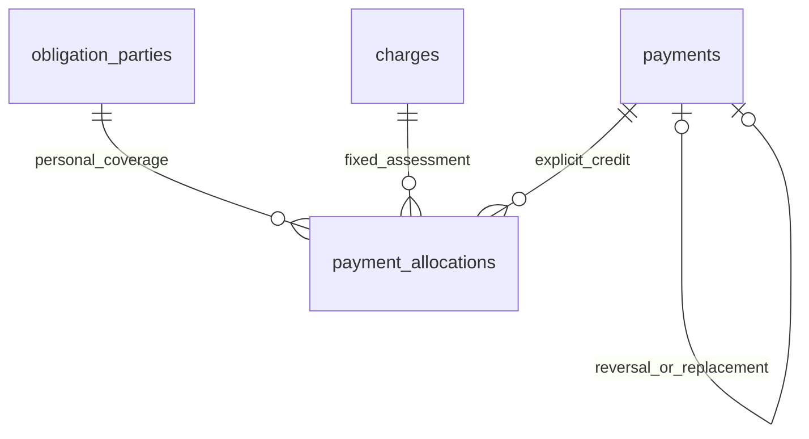

### FND-F05 — publish A/B: ограничено hosted приемане, frontend release предстои

Exact [20261103064400](../../supabase/migrations/20261103064400_financial_publish_a.sql) е приложена на 03.11.2026 след single-candidate dry-run/hash gate. При приемането на A backend имаше29 миграции/39 public+private приложни таблици. При B/2 и отделната feed поправка бяха31 миграции; след payment/account/inbound са34; тогава клонът имаше30 SQL файла без отделната PR #8 версия; актуалният P2 включва историята ѝ. B/2 не добавя таблици. Три public таблици и една private receipt таблица, всичките с RLS. Няма промяна на старите SQL, нови Auth акаунти или deployment. Frontend е draft PR #9, извън main/production.

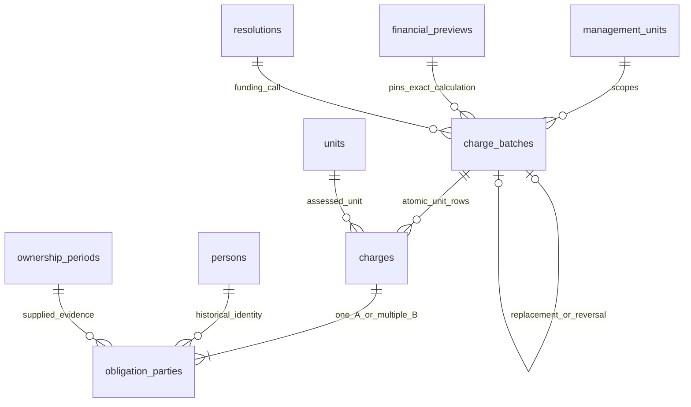

**B/2 — ограничено hosted API/UI/MVCC PASS (04.11.2026):** N-party отношението е приложената20261103171619. Новият service използва v2 RPC; legacy load/write отказват B, а legacy feed остава A-only. Отделната20261104073315 материализира source feed веднъж и отстранява hosted timeout, без промяна на авторизацията/данните. SQL counterpart използва приетата лична политика с parity checks; няма втори JS алгоритъм. Full unpaid reversal отменя всички parties при фиксирани обектни суми. Шест API групи, три independent PostgreSQL races с observed waiters и реален UI към hosted са проверени; [точен договор и ограничения](PERSONAL_ALLOCATION.md).

Отделни domain/service/UI/controller модули използват guarded RPC load/save/review/publish/feed. `prepare_charges` подготвя; `publish_charges` преглежда всяка лична отговорност и публикува целия batch; replacement изисква и `correct_finance`. Те са изрични scoped назначения, без admin наследяване или автоматичен owner достъп. Клиентът подава preview ID/основание и точни revisions, а не суми, actor, snapshot или свободно избран длъжник. Сървърът извежда и проверява източниците отново.

M/L/D/T/P са отделни; T е текущата сървърна дата Europe/Sofia, ownership покрива [M,T+1), а L/D са в M…T. Нов ден или променени входове изискват нов преглед с HTTP409. Това е ограничение на първия template, не универсална правна формула. Snapshot пази точния приет preview и `largest-remainder-unit-id-v1`, без преизчисляване или нормализация. Actor/key receipt, scope advisory lock и business unique индекси пазят и повторна операция с нов ключ. SHARE NOWAIT input barriers са консервативни; **пет конкретни конкурентни interleaving-а са hosted доказани с независими PostgreSQL сесии и наблюдавани PID/waiters**: first same-key replay, different-key business duplicate, uncommitted input writer→409, held authenticated correction→queued writer, competing unpaid corrections. Това не е изчерпателен MVCC/stress тест.

Публикуваните batch/charges/parties са неизменими. Неплатена корекция създава отрицателен обратен batch и нов положителен replacement в една транзакция; старите редове се пазят. При наличие на бъдещ payment/allocation модел първият correction template отказва до изрично интегриране на проверката за плащания. B2 сам не създава payment, payer, ledger или фондови операции; ръчните payment записи са отделният локален кандидат по-горе. Exact rational квотите, неподдържаните собственически режими и личният финансов портал остават отделни задължителни следващи стъпки. [Локални проверки и hosted gate](../../supabase/README.md#fnd-f05--локално-публикуване-a).

Реалният UI prepare/review/publish/navigation/reload е проверен към hosted;375/1440 light/dark снимките са действително разгледани. Same-JWT отнемането на правото е проверено. На04.11.2026 отделният естествен Europe/Sofia rollover достигна точно charge_day_changed/HTTP409 със стария review и без нови финансови/audit publication редове. Часовникът не е променян. Cleanup възстанови временния контекст и отне само собствените QA права/сесии, запазвайки synthetic финансовата история, старите A snapshots, демото и личните данни. Финансовият frontend остава извън main/production; следва отделен общ release review. [Приемане и release стъпка](../../supabase/README.md#fnd-f05--локално-публикуване-a).

### FND-F05 — целево hosted API/UI/MVCC приемане

Exact `20261102152437_financial_preview.sql` и петте зависими миграции са приложени: 28 hosted миграции / 35 приложни таблици. Тогава клонът имаше27 SQL файла без отделната handling версия; тя вече е включена чрез PR #8 интеграцията. Immutable `financial_previews` пази server-derived rule/share/date/basis/R и проверен ownership context. Целевите API/RLS/stale/same-JWT/UI проверки и осем контролирани MVCC случая преминаха с независими PostgreSQL сесии и наблюдавани waiters преди release. Проверени са replay/conflict, edit/review, phantom writer/NOWAIT и read-barrier сценарии; това не е гаранция за всички възможни interleavings или load test. Собствениците не получават лична сума/дълг; account links не участват. Frontend остава draft PR #9, извън main/production.

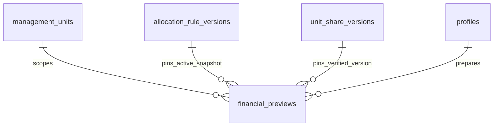

`prepare_charges` създава; `read_rules` или `prepare_charges` четат, без admin/prepare_rules/publish_rules наследяване. Два guarded RPC етапа derive-ват текущи входове и сравняват optimistic input fingerprint преди immutable insert/audit. Fingerprint е revision comparison, не подпис/authorization token. Кратки SHARE NOWAIT table barriers върху input таблиците блокират и phantom writers; busy→HTTP409 без retry. Ефектът е потвърден с действителен незавършен writer insert и обратен preview/read-barrier probe. Консервативната граница може да спира писатели и от други scopes; приемането не е измерване на production throughput или изчерпателен stress тест.

SQL numeric/integer и pure JS BigInt policy oracle ползват exact8decimal share validator. Резултатът пази floor/remainder/extra-cent/policy, сборът е точноR; старите snapshots не се пренаписват. Отделен financial-preview UI/service модул в съществуващата финансова страница. Самият preview няма лични задължения; charge_batches/charges/obligation_parties са в отделния publish A пакет по-горе. Няма ledger/payments/fund movement. [Договор и общо hosted приемане](../../supabase/README.md#fnd-f05--локален-начислителен-preview).

### Persisted идеални части — приложена версия на registry договора

Exact `20261102143241_unit_share_versions.sql` е приложена. Три таблици: физически denominator `unit_share_bases`, immutable `unit_share_versions` и отделни `unit_share_verifications`; нищо от предходните SQL файлове не се редактира. Registry модулът остава отделен от финансовите таблици; preview потребителят pin-ва точната проверена версия чрез guarded RPC.

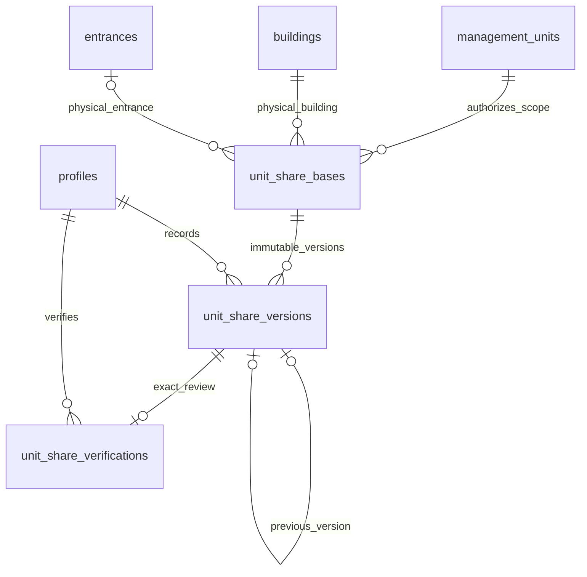

Участниците/unit IDs, процентните редове, provenance и периодът са в immutable packet, с DB проверки към физическите обекти и принадлежността им; не са съсобственически дялове. `read_registry` чете; само изрично `manage_registry` записва/проверява. Първият шаблон допуска целия състав в един whole-building management scope и изрично избрана сграда/вход; scope не установява знаменателя. Комплекс/подмножества общи части извън този шаблон не се поддържат. Exact8decimal text/SQL numeric; pure JS validator остава единственият клиентски аритметичен модул.

Корекцията добавя нова версия и обезсилва текущата проверка. Проверка изисква установен пълен roster, изрично проверени източници на всеки ред и точно100 във всеки сегмент. `unit_share_version_at` изисква точни version ID+дата; исторически snapshot се връща с `ready_for_new_use=false`. Текущата готовност се проверява отново спрямо регистровото покритие. Старите snapshots остават неизменни. UI е в „Сгради“, без owner/finance права или автоматично извеждане от площ. Локалните Edge-browser/PGlite/SDK/HTTP доказателства не са hosted PostgreSQL/MVCC гаранция.

DB-D/2 има локални и ordinary-session hosted API проверки за FND-F05 / основен ремонт по17(2)5: `resolutions.applicability` е structured gate, а `allocation_rule_versions` има редактиращи се draft редове и отделни immutable active варианти. Snapshot фиксира catalog/basis/evidence/review/participants/config/period; correction е explicit same-period supersession, старият ред не се променя. Current publish_rules, advisory/row locks, expected revisions, exact request UUID и UNIQUE защитават scoped activation/409/idempotence. Четирите financial candidates са приложени в общия28/35backend checkpoint, без нова таблица в самия DB-D/2. Няма начисления/плащания/ledger или правна гаранция. [Точен договор и hosted release план](../../supabase/README.md#db-d1--локални-финансови-чернови).

Финансовата основа е независима от main b5d9409/handling PR #8: domain → service → guarded private RPC/public invoker wrappers → financial UI/controller. Само financial_categories, resolutions и allocation_rule_versions; статутът active е immutable вариант, не публикувана production функция. prepare_rules редактира, read_rules чете, manager/publish_rules review-ва и активира само разрешения scope; без admin наследяване. Foundation review без structured qualification сам по себе си не разрешава activation. Local PGlite/Auth/serialized HTTP не е hosted/concurrency stress proof.

Само локалният DB-D/1 кандидат добавя следните отношения към съществуващата схема:

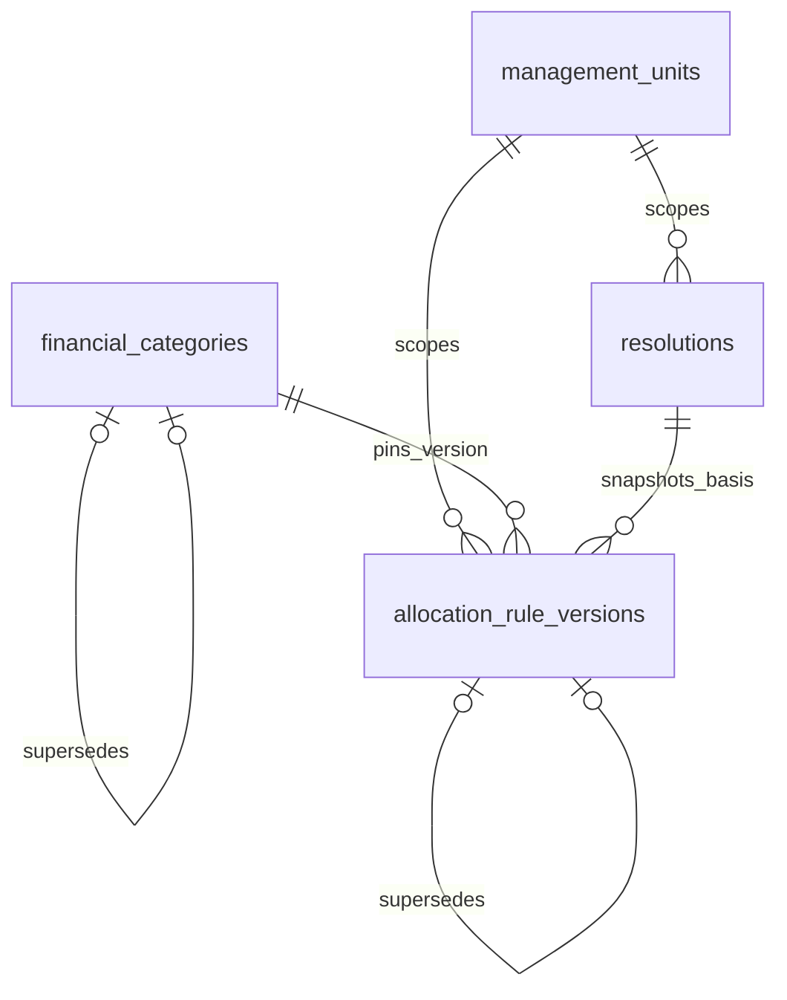

Правната опора е текстът на ЗУЕС чл.48 ал.1/3, проверен на02.11.2026 в официалното издание на МРРБ до ДВ49/2025. Пълна приложимост/кворум/актуалност за конкретен период не са автоматично удостоверени: legal_status=text_checked, записите needs_review. Идеални части на сградата не са съсобственически дялове; липсващ DB/API набор не се измисля или нормализира. Бъдеща активация изисква затворен правен договор и отделно изрично право.

Категория/отговорник: `ticket-handling` domain/BG ресурси → controller/UI → `ticket_assignees` и `update_ticket_handling` RPC. Сървърът проверява текущо `manage_tickets`, точния scope и активните назначения/периоди на получателя. Общата revision със статуса използва PT409; `handling_changed` пази before/after и причина. Отнетото назначение остава в историята, но не дава достъп. Няма нови таблици или capabilities. Exact `20261102080729` е приложена и hosted приемането премина:22 SQL файла/22 миграции/28 таблици, current/stale409/history/direct-DML/foreign/recipient/editor revoke с непроменени JWT. Реалният локален frontend към hosted backend е проверен; историята на PR #8 вече е включена в PR #9; frontend не е main/production. Числата22/28 са от тогавашното hosted приемане.

HTML/CSS/vanilla JavaScript/Bootstrap, Node/npm/Vite multi-page; Supabase DB/Auth/Storage и един JS Edge handler през supabase-js, REST/RPC и server-only S3 SDK. Няма React/Vue/TypeScript. Десет HTML входа са изрични във vite.config.js. Controllers са в src/pages, UI renderer-и в src/ui, операции в src/services, чисти правила в src/domain, ресурси/стилове в src/i18n и src/styles.

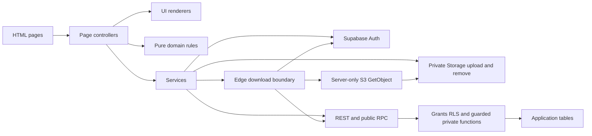

Статичният deployment публикува само dist. Public RPC са SECURITY INVOKER wrappers към минимално разрешени private SECURITY DEFINER функции с празен search_path и текуща Auth/permission проверка. private остава неизложена през Data API. Всички приложни public таблици имат RLS; няма anon grants за приложните данни/RPC. Direct writes са ограничени, а чувствителните операции са guarded RPC. user_metadata служи само за display name, никога за права.

Platform admin няма подразбиращ се operational достъп. Org admin управлява ограничени назначения; първият scope изисква отделно изрично manager предложение и приемане от точния получател. Runtime правата проверяват актуални profile/member/org/assignment/role периоди. Самоуправление не изисква фиктивна фирма. Controller чете, manager пише регистъра само с конкретните permissions. Cashier и пълният финансов/исторически owner портал още не са реализирани; минималният current owner изглед е описан по-долу.

## Действителна схема

### Приложение към сигнал — hosted backend и общ frontend release

Child PR #6 добавя една typed `ticket_attachments` таблица: общо 21 приложени миграции и 28 application tables, private `ticket-private-files` и отделен `download-ticket-file` ACTIVE v1. Историята на PR #5/#6 е включена в един общ release PR към main; конкретният production READY/live smoke се потвърждава за неговия commit. Reporter/current-owner и explicit scoped `manage_tickets` ползват ticket-only RPC; unit documents/`manage_documents` правата не се променят. Един активен PNG/JPEG/PDF до 5 MiB, pending→ready/tombstone→API removal→finish, audit и изрично прекратяване на недовършено качване. Owner reporter премахва само свое качване; служителят — всяко разрешено. Друг съсобственик не получава чужд сигнал или файл.

Shared byte transport пази auth→current caller RPC→fixed S3 key→size/hash→repeat RPC→no-store, с отделни typed RPC/bucket/ID/MIME validators. Ticket adapter добавя signature проверка и octet-stream attachment за SDK Blob; unit остава PDF и deployedv1 е непроменен. Hosted bytes/SHA/access/direct-bypass/new-request same-JWT role+link revoke/UI/cleanup преминаха;0objects/13removed histories/46audits. Няма full MIME decoder/AV. Реалният15min expiry е проверен като release gate. Controlled hosted mid-fetch revoke не е инжектиран и не е blocker според приетата new-request семантика; локалната двойна авторизация е доказана, без обещание за атомарно отменяне. [Точни резултати и release стъпки](../../supabase/README.md#минимално-приложение-към-сигнал--общ-frontend-release).

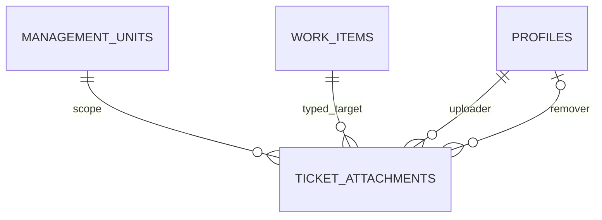

Описанието по-долу за parent минималните сигнали е неговият отделен hosted PASS; attachment има отделното приемане по-горе. Другите планирани категории/задачи/известия остават извън този пакет.

### Минимални сигнали: hosted приемане PASS, общ release

В този feature клон има десети HTML вход `pages/tickets.html`: отделни domain/tickets, services/tickets, ui/tickets и page controller. Service извиква guarded RPC; не приема client author/scope/status при create. Canonical `manage_tickets` се назначава изрично на scoped manager; registry/document/platform/org права не го заместват. Owner list е пресечението от собствено авторство и текущата my_owned_units проекция. Real hosted role/link revocation със същия JWT, own/foreign-author/scope isolation и local browser→hosted UI са проверени; frontend е включен в общия release. Минималното hosted приемане е затворено: exactPT409корекцията е приложена и един real-browser current/staleHTTP409/reload тест премина, с unchangedrow/events при отказ и точенcleanup. Целият REQ009/MVP не е завършен.

Приложената20261101141944 добавя две таблици (27hosted), с RLS, SELECT само върху разрешени записи, без client DML grants, private guarded операции и invoker wrappers. Row lock/expected_revision защитават status update, събитията са append-only. Приложената20261101180527 променя само кода за stale conflict, без нови таблици/права. Категория/отговорник/задачи/прикачвания/известия не са реализирани от тази ограничена стъпка. Исторически нефинансов owner достъп остава отделен договор.

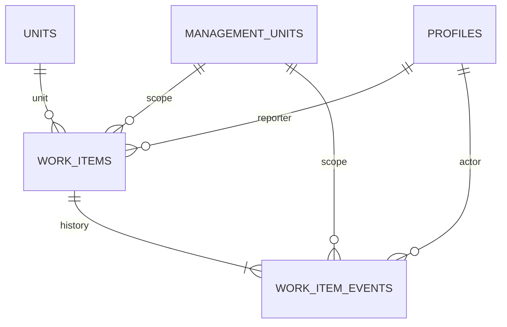

Диаграмата по-горе описва двете signal таблици; диаграмите по-долу описват останалите25 таблици. Събитията имат composite scope/item FK. Този пакет не променя unit-file Storage правата и не добавя owner upload.

**20 приложени миграции;27 приложни таблици —23 в public и4 в private**. Всички20локалниSQLфайла са приложени; последният коригира private функция без нова таблица. Броят не включва управляваните Supabase auth/storage таблици. По-долу са основните физически FK; диаграмите не са пълен списък на колоните, индексите и composite constraints. PRIVATE_ префиксът означава реалната private схема, не допълнителни public таблици.

### Достъп и физически registry

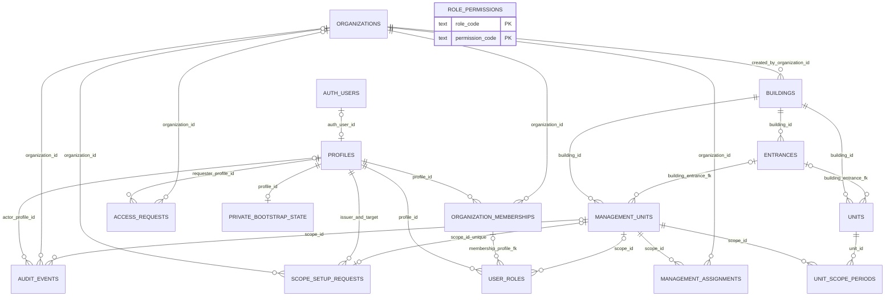

ROLE_PERMISSIONS е каталог, а не FK от permissions масива; валидността на назначенията се налага с trigger/функции. SCOPE_SETUP_REQUESTS има отделни issuer/target profile FK, показани събрано. Lifecycle-ът на organization requests включва revision, correction/withdraw/reject/activate и audit. Bootstrap е затворена операторска операция, не public RPC. Адресът не дава права и не слива физически записи.

### Scoped лица, собственост и обитаване

```mermaid
erDiagram
    MANAGEMENT_UNITS ||--o{ PERSONS : scope_id
    MANAGEMENT_UNITS ||--o{ ACCOUNT_PERSON_LINKS : scope_id
    PERSONS ||--o{ ACCOUNT_PERSON_LINKS : scope_person_fk
    PROFILES ||--o{ ACCOUNT_PERSON_LINKS : profile_id
    PROFILES ||--o{ ACCOUNT_PERSON_LINKS : verified_by
    PROFILES o|--o{ ACCOUNT_PERSON_LINKS : revoked_by
    PERSONS ||--o{ PRIVATE_PERSON_REVISIONS : person_id
    MANAGEMENT_UNITS ||--o{ OWNERSHIP_PERIODS : scope_id
    UNITS ||--o{ OWNERSHIP_PERIODS : unit_id
    UNIT_SCOPE_PERIODS ||--o{ OWNERSHIP_PERIODS : scope_period_fk
    PERSONS ||--o{ OWNERSHIP_PERIODS : scope_person_fk
    OWNERSHIP_PERIODS o|--o| OWNERSHIP_PERIODS : replaces_id_unique
    UNITS ||--o{ OWNERSHIP_SET_REVIEWS : unit_id
    MANAGEMENT_UNITS ||--o{ OWNERSHIP_SET_REVIEWS : scope_id
    UNITS ||--o{ PRIVATE_OWNERSHIP_BATCHES : unit_id
    MANAGEMENT_UNITS ||--o{ PRIVATE_OWNERSHIP_BATCHES : scope_id
    MANAGEMENT_UNITS ||--o{ OCCUPANCY_PERIODS : scope_id
    UNITS ||--o{ OCCUPANCY_PERIODS : unit_id
    UNIT_SCOPE_PERIODS ||--o{ OCCUPANCY_PERIODS : scope_period_fk
    PERSONS o|--o{ OCCUPANCY_PERIODS : nullable_scope_person_fk
    OCCUPANCY_PERIODS o|--o| OCCUPANCY_PERIODS : replaces_id_unique
    UNITS ||--o{ OCCUPANCY_SET_REVIEWS : unit_id
    MANAGEMENT_UNITS ||--o{ OCCUPANCY_SET_REVIEWS : scope_id
    UNITS ||--o{ PRIVATE_OCCUPANCY_BATCHES : unit_id
    MANAGEMENT_UNITS ||--o{ PRIVATE_OCCUPANCY_BATCHES : scope_id
    PROFILES ||--o{ PERSONS : recorded_by
    PROFILES ||--o{ OWNERSHIP_PERIODS : recorded_by
    PROFILES ||--o{ OCCUPANCY_PERIODS : recorded_by
    PROFILES ||--o{ OWNERSHIP_SET_REVIEWS : reviewed_by
    PROFILES ||--o{ OCCUPANCY_SET_REVIEWS : reviewed_by
    PROFILES ||--o{ PRIVATE_OWNERSHIP_BATCHES : actor_id
    PROFILES ||--o{ PRIVATE_OCCUPANCY_BATCHES : actor_id
```

Person/period composite FK включват scope и не позволяват чуждо scoped лице. Ownership/occupancy записите се отнасят към конкретен unit_scope_period; trigger проверява unit и съдържане на периода. Неизобразените nullable verifier/retirer FK сочат PROFILES. Review record_ids са UUID масиви, не FK към всеки period; функцията ги проверява и пази fingerprint. PRIVATE_PERSON_REVISIONS пази JSON snapshot, а private batch таблиците — idempotent request payload/result. И четирите private таблици имат RLS и нямат пряк клиентски достъп.

Има account_person_links за проверена самоличност. Няма unit_share_versions, Storage metadata, work_items, finance или notifications таблици. Не се рисуват бъдещи отношения като вече създадени.

## Поведение на registry

- Принадлежност на имота към избрана дата: strict ISO business dates, [начало,край), today Europe/Sofia; това е филтър със сегашните права/полета, не historical field snapshot.
- DB-B metadata: source kind/reference, known_from, author/time, needs_review/verified. Липсваща площ остава неизвестна. Един source packet обосновава целия минимален ред; mixed-source partial editor предстои.
- Scoped persons: optional contacts, отделна verification, expected revision, private history. Equal name/email не слива записи. Person е различен от Auth profile; не е нужен акаунт за всеки собственик.
- Ownership: fraction>0≤1, numeric(12,10), exact decimal text; partial set е разрешен,>1 и overlap на person/unit са отказани. Exact1+all rows verified+explicit set review е отделна проверка; без нормализация или auto owner access.
- Occupancy: individual physical person=1 или aggregate whole-unit declaration с nullable whole count≥0. Owner-resident, right-of-use resident, tenant-resident и other са отделни декларирани статути. Unknown, declared0 и verified0 се различават. Mixed aggregate/individual overlap и same-person/unit overlap са отказани. Parent person revision/kind промяна обезсилва проверката до fresh correction.
- Ownership/occupancy corrections: atomic≤20 changes/unit, lock, request key, fresh source/history limitation/reason; оригиналите остават immutable с retirement evidence. Отделни row/set reviews и fingerprint invalidation. RLS read_registry; RPC manage_registry; без direct client writes.

Периодът known_from не е дата на придобиване. Няма фиктивна предходна история, automatic debt transfer, законови exemption правила или начисляване по дни. Verified означава служебен преглед, не държавна/правна заверка или финансова готовност.

## Domain-only идеални части

src/domain/unit-shares.js експортира percentageUnits, percentageText, assessUnitShares. Процентни пунктове, decimal text с≤8 знака, BigInt scale100000000; missing≠invalid0,0<value≤100. Идеалните части на имота не са ownership fractions на съсобствениците.

assessUnitShares приема basis (key/revision/kind/building_id/entrance_id/verified), participants (basis/revision/unit_ids/verified/period), current rows и интервал. JSDoc е точният input/output договор. Резултатът съдържа valid/reviewed rows, причини и сегменти с exact known_total/difference; known subtotal не замества липсващо число. Състоянията са conflict/wrong_basis/missing/unreviewed/partial/ready. Няма rounding/epsilon, скрито допълване или ребазиране на building проценти към entrance. Целият предоставен current snapshot се проверява консервативно; retired originals не участват.

**Без API/UI/DDL интеграция.** ready оценява supplied assertions, не установява истинността на verified, правна приложимост или достъп и не записва set review. Бъдещият server слой трябва да установи реалните права/доказателства/състав/ревизии. SQL basis representation още е отворен въпрос.

## Auth, live и доказателства

Brevo Free custom SMTP обслужва само Auth confirmation/reset при Confirm Email ON. Реалните отделни signup и recovery PKCE сценарии са преминали; стар flow_state_expired е исторически неуспех, не текущ blocker. UI password8–256+ASCII digit; hosted minimum8 без character requirements допуска API парола без цифра. Единна server политика предстои преди бизнес старт. Login на съществуващи потребители не е принудително променян.

Запазени са ordinary-session2-org/pending RLS allow/deny, local PostgreSQL rebuild, domain boundary/concurrency проверки и реални Edge local/live screenshot/reload/theme проверки. Domain-only shares има17 synthetic групи; occupancy —9 local DB и9 hosted API групи плюс subject guard. Тези са резултати от съответните feature checkpoints, не нови тестове при документационна редакция. PGlite Auth fixtures и операторски setup не са доказателство за hosted Auth/RLS. QA artifacts и credentials остават локални.

Netlify: съществуващото repo/main, npm run build→dist, Node24, security headers/CSP от netlify.toml, без SPA fallback. Ready deployment и live UI smoke се отчитат отделно. Storage/theme се обединяват в един release PR и един production trigger. Dashboard остава каталог. Пълният финансов/исторически owner портал, сигнали, import/export, finance/reports и in-app notifications предстоят. Demo достъпът още не е подготвен; личният platform admin не се използва за demo.

## Минимален current owner projection

account_person_links пази exact profile/scoped person, person_revision, verified actor/time, evidence/note/request_key и еднократно revocation evidence/actor/time. Unique active person link, immutable originals, direct writes denied; base SELECT само за current verifier. my_owned_units извежда actor от потвърдената Auth сесия и връща unit ID/number/type и building/entrance/scope labels. Active link, active verified current person revision, verified current ownership и unit_scope/management periods се проверяват при всяко четене. Няма caller-supplied profile, base-table owner grants, чужди контакти/дялове, finance/history или operational permission от link. Pending target може да стане active след проверката, без служебни назначения.

verify_owner_access е optional manager permission с read_registry. Org admin на управляващата scope org го включва на друг existing manager чрез set_owner_verifier с основание/audit; generic staff INSERT не го дава. Верификаторът не потвърждава собствен profile или вече свързаната си идентичност. manage_registry, manage_members и platform_admin не го наследяват. Прекратена проверяваща роля спира следващо confirm/revoke, но не отменя автоматично независимо вече проверена самоличност. Link revocation или изтекла ownership връзка спират следващия owner query със същия JWT; показаният вече текст не може да бъде физически изтрит от устройството. UI прави нов read при обновяване/focus и не използва стар async response.

Каноничното име е verify_owner_access от първоначалния onboarding модел; няма второ сходно право. Минималният UI е в Account/Buildings/Organization admin, без нов сайт. Чистите PostgreSQL, ordinary-session API и реалните локални Edge проверки са отделни доказателства; пълният owner портал остава бъдещ зависим пакет.

## Подготвен private-file компонент — локален кандидат, НЕ hosted схема

Историческият първи unit-file подетап добави public.documents като15-а миграция; следващите Storage correction/Edge и signal миграции водят до текущите20приложени/27таблици, описани по-горе. Typed unit FK остава минималната едноцелна конкретизация на документ; multi-target document_links и версии не са реализирани. Сигналите не наследяват owner upload право. [Договор за private файл](../../supabase/README.md#договор-за-private-файл).

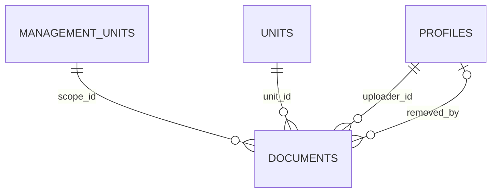

UI controller unit-files → service unit-files → guarded document RPC + Storage upload/remove; двата byte read пътя минават през един JS Edge download handler по document ID. Handler: Auth getUser → caller-JWT RPC/current session и DB права → exact-key server-only S3 GetObject → bounded size/hash → повторна RPC авторизация → no-store attachment. Няма директен download/signing fallback; приложената policy оставя Storage SELECT само за разрешено tombstone removal. Чистият domain валидира filename/MIME/size и SHA256; BG ресурси и DOM renderer са отделни. Owner audience е изрична и default staff; няма owner upload. S3 key bypass-ва RLS и е само Edge secret; не се използва за caller authorization. Локалният QA transport е само test helper; отделното hosted приемане използва действителни Storage/S3/Edge и ordinary sessions.

## Private-file hosted status —01.11.2026

Приложени са четирите Storage миграции:20261031113950,20261101081203,20261101082303 и20261101094452; общо18 миграции/25 application tables, без нова таблица в последния пакет. Старите SQL са неизменени. Предишният cached-byte FAIL е запазен като история; Edgev1/S3 handler е deployed и hosted приемането е PASS: реални621byte/5MiB SHA256, default/owner isolation, direct/signing/S3 user-token откази, role И owner-link revoke със същия JWT, no-store/DYNAMIC headers и cleanup. Actual browser/local frontend→hosted upload/download/removal е проверен;2screenshots375light/1440dark са действително разгледани. Общият release включва source PR2/PR3 без нови backend операции; преди main се проверяват merged build/navigation/theme/Storage UI-service интеграцията, после тесен live smoke. Няма повторен hosted RLS/PKCE набор или load test. Виж [setup и release стъпките](../../supabase/README.md).
