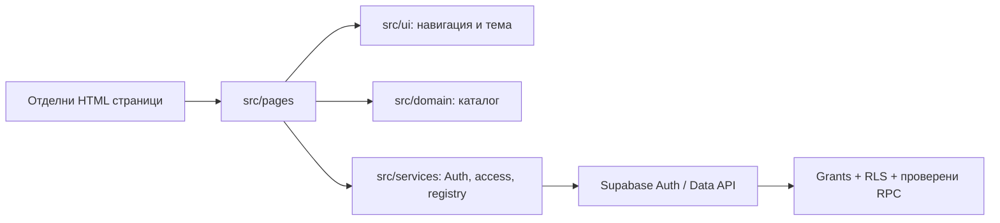
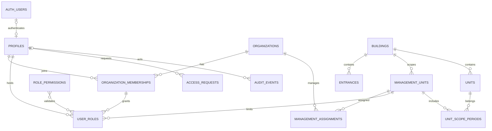

# Реализирана архитектура

HTML/CSS/чист JavaScript/Bootstrap, Node/npm/Vite. Отделни входове: `index.html`, `pages/dashboard.html`, `pages/buildings.html`, `pages/account.html`, `pages/admin.html`. Общият ES module зарежда навигация, тема, BG ресурси и каталог. Контролерите в `src/pages` обработват формите; `src/ui` съдържа споделени UI операции, `src/services` извиква Supabase SDK/Auth/Data API. Няма React/Vue/TypeScript.

Тъмната тема използва Bootstrap `data-bs-theme` и `localStorage` ключ `propertyhub.theme` (само предпочитание, без лични данни). При забранен storage изборът работи в текущата страница. CSS tokens са в `src/styles/main.css`. Няма analytics.

DB-A/B миграциите са приложени в установения Supabase проект. Има 13 приложни таблици в public и затворена private.bootstrap_state. Всички public таблици имат RLS. Няма anon grants за приложните таблици/RPC. Само колони за собствено име/предпочитания имат директен UPDATE; добавянето на регистър и административните промени минават през контролирани функции. Public RPC са SECURITY INVOKER обвивки към изрично разрешени, проверяващи текущата Auth идентичност SECURITY DEFINER функции в неизложената private схема, с фиксиран празен search_path. Bootstrap няма public обвивка или клиентски EXECUTE. Audit е append-only чрез доверените операции. [Миграции, setup и проверки](../../supabase/README.md).

Профилът има собствен UUID и отделна уникална auth_user_id връзка. След потвърден вход ensure_profile създава pending профил без роля. Потвърден имейл не доказва собственост/служебно право. Единствено името за представяне може да се вземе от user_metadata; права не се извеждат от metadata. Първото platform назначение изисква доверен оператор, точен одобрен и потвърден Auth UUID и еднократно фиксиране в bootstrap_state. Реалният bootstrap предстои до предоставяне на този target.

Platform admin активира проверена заявка за организация и първо org admin назначение. Org admin управлява разрешените manager/controller назначения в собствените активни org/scopes; няма автоматичен registry/finance достъп. Manager работи с изрични read_registry/manage_registry; controller чете. Проверяват се текущи profile/role/membership/org/management assignment/status/периоди при всяка заявка. Архивиране/редакция на регистъра, касиерски функции, покани с токени, owner links и финансови операции следват в отделни пакети.

Диаграмата показва основните отношения. ROLE_PERMISSIONS→USER_ROLES се валидира с trigger/контролирана функция, а не с масивен FK. Composite FK пазят entrance/building и membership/profile съвместимост; trigger валидира unit/scope; exclusion constraints забраняват припокрити membership/management/unit-scope периоди. Няма автоматично сливане по адрес или прехвърляне на чуждо управление.

Преминали са 17 локални PostgreSQL групи с тестови Auth fixtures; те не са live Auth сесии. Потребителят потвърди реални login, pending без административни/registry права, logout/reload и повторен login; DB потвърждава confirmed Auth и pending профил без роли. Confirmation връзката е върнала грешка, въпреки че акаунтът е потвърден. Обработката вече различава изтекла/използвана връзка, session проблем и доказана текуща confirmed сесия, без да твърди конкретна причина за историческия случай или да отразява token/error_description. Нов чист callback още не е проверен. Реалният 2-org набор е подготвен, но чака синтетични акаунти. Bootstrap/назначенията с реални роли, Storage и live deployment предстоят; DEV-02 не е приет изцяло.

`vite build` включва само изричните HTML входове и техните зависимости. Планиращият пакет е игнориран от Git; достъпът до него през dev сървъра е забранен. За hosting се използва само `dist/`. Development и preview се обвързват към loopback, не към LAN.
