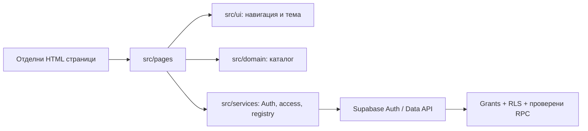
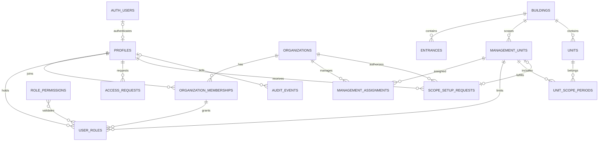

# Реализирана архитектура

DEV-03/1 използва съществуващите units/unit_scope_periods за read-only преглед по принадлежност към дата: valid_from ≤ date и (valid_to IS NULL или date < valid_to). Service филтърът се изпълнява през обикновената потребителска сесия и текущите RLS; изборът на дата не създава историческо право. Domain модулът валидира календарната дата и задава Europe/Sofia днес; отделният UI renderer показва provenance без HTML интерполация на данни. Controller generation check изключва стари асинхронни отговори при смяна на избора. Няма нови schema/permissions; current unit стойности и периодна принадлежност не се представят като исторически field snapshots.

`npm.cmd run check:registry-snapshot` възпроизвежда целевите browser/API проверки върху localhost preview със съществуващите синтетични RLS credentials/fixture manifest. Не създава fixtures и не записва регистърни данни. Screenshots/JSON са само в ignored `.local/registry-snapshot-qa/`; автоматичният резултат изисква отделен действителен визуален преглед. Проверени са 4 комбинации 375/1440 light/dark, преди начало/включено начало и отказан чужд scope.

Password reset използва формата в `login.html` и recovery секция в `account.html`, без нов redirect адрес. `src/services/auth.js` извиква `resetPasswordForEmail`, проверява текущия потребител чрез `getUser` и извиква `updateUser` за собствената парола. SDK обработва PKCE; callback кодът се отстранява от URL след инициализация. Tab-local recovery marker пази само UI намерение при reload, не токени/пароли или авторизационни права. Supabase Auth налага валидната сесия и password policy; приложните роли остават в DB. Локалният browser contract тест не замества реалната SMTP доставка и recovery проверка.

Текущ Auth резултат: чист live signup с отделен нерегистриран адрес е PASS: доставено/лично отворено confirmation писмо, PKCE HTTP200, потвърден собствен pending профил, нула роли/организации/контексти и logout/relogin с действителни ordinary-session SELECT/RPC проверки. По-ранният signup flow_state_expired остава исторически FAIL. Отделният реален live recovery тест е PASS: Brevo Sent/Delivered и получено писмо, PKCE HTTP200, проверен Auth user, updateUser HTTP200, logout, new-password login и old-password invalid_credentials отказ. След възстановяването actual ordinary-session записи отново потвърждават pending без роли/организации/контексти. Тестовите имейли, паролите и еднократните връзки не са част от публичния пакет.

HTML/CSS/чист JavaScript/Bootstrap, Node/npm/Vite. Девет HTML входа: начало, dashboard, buildings, account, login, register, platform-admin, organization-admin и съвместимият admin навигационен индекс. Регистрация/вход и двата административни процеса имат отделни файлове. Общият ES module зарежда навигация, тема, BG ресурси и каталог. Контролерите в `src/pages` обработват формите; `src/ui` съдържа споделени UI операции, `src/services` извиква Supabase SDK/Auth/Data API. Няма React/Vue/TypeScript.

Тъмната тема използва Bootstrap `data-bs-theme` и `localStorage` ключ `propertyhub.theme` (само предпочитание, без лични данни). При забранен storage изборът работи в текущата страница. CSS tokens са в `src/styles/main.css`. Няма analytics.

DB-A/B миграциите са приложени в установения Supabase проект. Има 14 приложни таблици в public и затворена private.bootstrap_state. Всички public таблици имат RLS. Няма anon grants за приложните таблици/RPC. Само колони за собствено име/предпочитания имат директен UPDATE; добавянето на регистър и административните промени минават през контролирани функции. Public RPC са SECURITY INVOKER обвивки към изрично разрешени, проверяващи текущата Auth идентичност SECURITY DEFINER функции в неизложената private схема, с фиксиран празен search_path. Bootstrap няма public обвивка или клиентски EXECUTE. Audit е append-only чрез доверените операции. [Миграции, setup и проверки](../../supabase/README.md).

Профилът има собствен UUID и отделна уникална auth_user_id връзка. След потвърден вход ensure_profile създава pending профил без роля. Потвърден имейл не доказва собственост/служебно право. Единствено името за представяне може да се вземе от user_metadata; права не се извеждат от metadata. Първото platform назначение изисква доверен оператор, точен одобрен и потвърден Auth UUID и еднократно фиксиране в bootstrap_state. След личния pending тест и предоставен от потребителя UUID bootstrap е изпълнен на 29.10.2026: проверени са active профил, един platform_admin/manage_platform grant и съответстващи bootstrap/audit записи, без организационни или оперативни роли.

Platform admin активира проверена заявка за организация и първо org admin назначение. Org admin управлява разрешените manager/controller назначения в собствените активни org/scopes; няма автоматичен registry/finance достъп. Manager работи с изрични read_registry/manage_registry; controller чете. Проверяват се текущи profile/role/membership/org/management assignment/status/периоди при всяка заявка. Архивиране/редакция на регистъра, касиерски функции, покани с токени, owner links и финансови операции следват в отделни пакети.

Началният scope използва отделна административна заявка за manager пакет към точен confirmed акаунт, с 48h срок и преглед на текущото право на издателя. Само получателят приема: физическият контекст, членството и изричният manager grant се записват атомарно. Чист org admin не наследява оперативни права; старият `create_management_context` е затворен. Org staff projection показва минималните назначения в собствената организация, без глобален профилен каталог. Organization onboarding вече допуска корекция, оттегляне, отказ и активация с основание/exact revision; token invites и owner links остават затворени.

Шестте DB-B таблици пазят typed source kind/reference, known_from, needs_review/verified, recorder/reviewer/time/note. При създаване стойностите са непроверени; липсваща площ остава неизвестна и след преглед на останалите стойности. Един source packet покрива въведените стойности на реда. Field-level evidence за смесени източници и исторически редакции трябва да предшества отварянето на такива операции. Verified ред не е финансова готовност; ownership периодите са реализирани в отделния DB-C/2 пакет по-долу; обитаване, идеални части и финанси предстоят.

Диаграмата показва основните отношения. ROLE_PERMISSIONS→USER_ROLES се валидира с trigger/контролирана функция, а не с масивен FK. Composite FK пазят entrance/building и membership/profile съвместимост; trigger валидира unit/scope; exclusion constraints забраняват припокрити membership/management/unit-scope периоди. Няма автоматично сливане по адрес или прехвърляне на чуждо управление.

Преминали са 22 локални PostgreSQL групи с тестови Auth fixtures; те не са live Auth сесии. Потребителят потвърди реални login, pending без административни/registry права, logout/reload и повторен login преди bootstrap. Confirmation връзката е върнала грешка, въпреки че акаунтът е потвърден. Обработката вече различава изтекла/използвана връзка, session проблем и доказана текуща confirmed сесия, без да твърди конкретна причина за историческия случай или да отразява token/error_description. Чист нов signup callback вече е проверен с реално доставено писмо и PKCE сесия. Bootstrap записите са проверени операторски. След отделен Auth Admin setup са изпълнени 11 hosted групи с три обикновени password сесии и publishable ключ, плюс logout: първо scope/manager приемане, действителни unit/period записи, cross-org SELECT/INSERT/UPDATE/DELETE откази, pending/metadata/self-elevation, staff projection, provenance, requester lifecycle и revocation със същата сесия. Operator fixture SQL създава само двете синтетични организации/org admin основания и не служи за RLS доказателство. Fixtures остават за инспекция. Чист email callback и recovery вече са проверени; Storage предстои в DEV-04.

`vite build` включва само изричните HTML входове и техните зависимости. Планиращият пакет е игнориран от Git; достъпът до него през dev сървъра е забранен. За hosting се използва само `dist/`. Development и preview се обвързват към loopback, не към LAN.

Допълнително са преминали 18 реални Playwright/Edge случая за org/registry: две ширини, две теми, разрешен/pending достъп, own-org опции, навигация/reload и browser errors. Всички snapshots са действително прегледани; danger outline contrast е поправен и целево проверен при четирите комбинации (6.05:1 light, 8.54:1 dark). UI scope request/revoke и unit create/verify са проверени с реалните записи през ordinary A сесия; неизвестната площ остава NULL. Последващият live appointments набор проверява UI scope приемане/staff assign/revoke; clean email callback вече е проверен с отделна реална signup сесия.

Ранният Netlify production deploy вече е на https://propertyhub-ilopolo.netlify.app. Изрично свързан е съществуващият GitHub `ilopolo/PropertyHub`/main с build `npm run build`/publish `dist`. CSP и останалите security headers са проверени върху live responses; автоматичният hosting badge е изключен за отстраняване на CSP violations. Live 18-case org/registry матрицата е повторена и всичките снимки са прегледани. Отделни 11 smoke групи проверяват деветте HTML входа с reload/themes/headers, pending login/logout/relogin и отрицателните callbacks. Site URL и точният HTTPS account redirect са записани и проверени след reload; локалните redirects са запазени. Последващият live UI appointments набор премина exact-recipient scope acceptance с отделен manager grant и controller assignment/revocation само с read_registry; действителните редове са проверени с ordinary A сесия. Четирите inbox screenshots са прегледани; 8 целеви A retests са PASS. Положителните live signup/confirmation/PKCE и recovery сценарии също са проверени с реалните сесии и записи.

### DB-C/1 scoped persons

`persons` is partitioned by immutable management scope. RLS requires current `read_registry`; all client writes are revoked. Public security-invoker RPCs delegate to private guarded save/verify functions requiring current `manage_registry`. Org/platform administration gives no operational inheritance. There is no name/email uniqueness, automatic identity merge, Auth link or ownership grant.

The minimal editor reasserts the entire record from one declaration/document source packet. Server-generated per-field evidence covers each supplied non-null field. An optimistic revision check prevents stale replacement/review; replacement preserves a private snapshot and resets verification. Mixed-source partial editing and public historical-person projections remain outside this step. Audit payloads contain revision IDs, not contacts. Blank contacts stay unknown; verified does not imply a complete registry or financial readiness.

Password validation is shared by registration and both password-update paths, excluded from login. The accepted temporary hosted minimum is 8 without character classes; UI additionally requires a digit. Hosted Management API enumerates policies and does not expose digit-only requirements. This is an explicit API/UI difference, to resolve before business launch; no private hook or paid mechanism is introduced.

### DB-C/2 ownership periods

Migration `20261030194407_ownership_periods.sql` adds `ownership_periods`, `ownership_set_reviews` and closed `private.ownership_batches`. Current read_registry governs RLS/reads; guarded private functions behind public invoker RPCs require manage_registry for writes/reviews. Direct client writes and anonymous access are revoked. Composite person/scope and unit-scope-period references prevent cross-scope linking; the ownership interval must fit a recorded unit scope period. No account-person or financial tables are modified.

Each request changes one unit atomically, locks that unit and uses a persistent request key/payload/actor check. Immutable original facts remain after replacement or void, with retirement actor/time/reason/evidence. New rows carry a person-name/revision snapshot, source packet, known-from date and history limitation. Fraction input is validated as decimal text before numeric(12,10) conversion; reads return strings. Every relevant interval start is checked for total<=1, including future segments; coowners may overlap, the same person/unit may not. No normalization or debt transfer occurs.

Row verification is separate from explicit set review for a date. A reviewed set needs total=1 and all applicable rows verified. A fingerprint of those facts/reviews makes changed sets unreviewed while retaining old review records. This is staff evidence of registry completeness, not legal certification or financial readiness. Historical corrections do not fabricate earlier facts or retarget financial parties. The UI stages a batch before one submit and waits for the selected scope/unit to finish loading before enabling edits.
