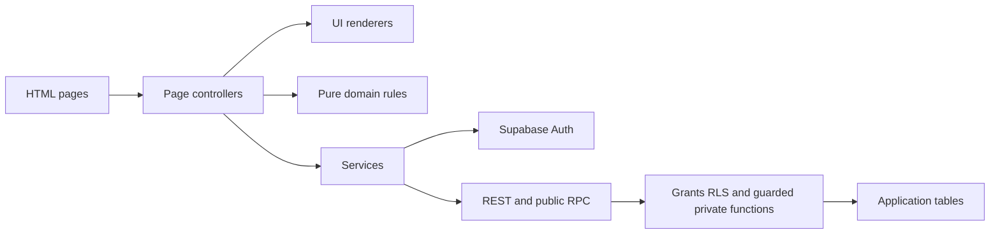
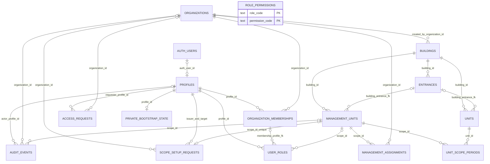
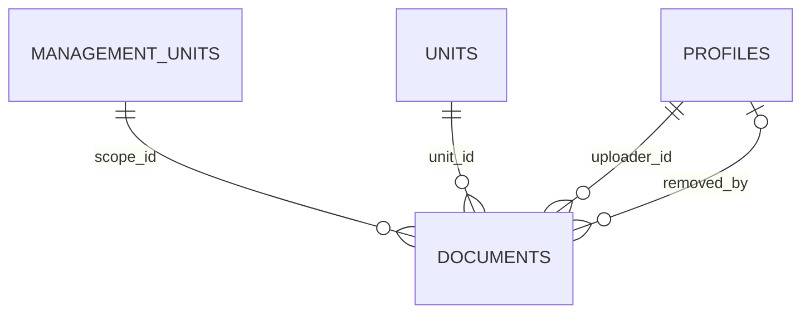

# Реализирана архитектура

Актуализация:31.10.2026. Реализираният поднабор е Auth/admin/registry; целият университетски MVP остава незавършен. [README](../../README.md) · [Supabase setup и миграции](../../supabase/README.md).

## Стек и граници

HTML/CSS/vanilla JavaScript/Bootstrap, Node/npm/Vite multi-page; Supabase DB/Auth през supabase-js и REST/RPC. Няма React/Vue/TypeScript. Девет HTML входа са изрични във vite.config.js. Controllers са в src/pages, UI renderer-и в src/ui, операции в src/services, чисти правила в src/domain, ресурси/стилове в src/i18n и src/styles.

Статичният deployment публикува само dist. Public RPC са SECURITY INVOKER wrappers към минимално разрешени private SECURITY DEFINER функции с празен search_path и текуща Auth/permission проверка. private остава неизложена през Data API. Всички приложни public таблици имат RLS; няма anon grants за приложните данни/RPC. Direct writes са ограничени, а чувствителните операции са guarded RPC. user_metadata служи само за display name, никога за права.

Platform admin няма подразбиращ се operational достъп. Org admin управлява ограничени назначения; първият scope изисква отделно изрично manager предложение и приемане от точния получател. Runtime правата проверяват актуални profile/member/org/assignment/role периоди. Самоуправление не изисква фиктивна фирма. Controller чете, manager пише регистъра само с конкретните permissions. Cashier и пълният финансов/исторически owner портал още не са реализирани; минималният current owner изглед е описан по-долу.

## Действителна схема

**17 миграции;25 приложни таблици —21 в public и4 в private**. Броят не включва управляваните Supabase auth/storage таблици. По-долу са основните физически FK; диаграмите не са пълен списък на колоните, индексите и composite constraints. PRIVATE_ префиксът означава реалната private схема, не допълнителни public таблици.

### Достъп и физически registry

ROLE_PERMISSIONS е каталог, а не FK от permissions масива; валидността на назначенията се налага с trigger/функции. SCOPE_SETUP_REQUESTS има отделни issuer/target profile FK, показани събрано. Lifecycle-ът на organization requests включва revision, correction/withdraw/reject/activate и audit. Bootstrap е затворена операторска операция, не public RPC. Адресът не дава права и не слива физически записи.

### Scoped лица, собственост и обитаване

```mermaid
erDiagram
    MANAGEMENT_UNITS ||--o{ PERSONS : scope_id
    MANAGEMENT_UNITS ||--o{ ACCOUNT_PERSON_LINKS : scope_id
    PERSONS ||--o{ ACCOUNT_PERSON_LINKS : scope_person_fk
    PROFILES ||--o{ ACCOUNT_PERSON_LINKS : profile_id
    PROFILES ||--o{ ACCOUNT_PERSON_LINKS : verified_by
    PROFILES o|--o{ ACCOUNT_PERSON_LINKS : revoked_by
    PERSONS ||--o{ PRIVATE_PERSON_REVISIONS : person_id
    MANAGEMENT_UNITS ||--o{ OWNERSHIP_PERIODS : scope_id
    UNITS ||--o{ OWNERSHIP_PERIODS : unit_id
    UNIT_SCOPE_PERIODS ||--o{ OWNERSHIP_PERIODS : scope_period_fk
    PERSONS ||--o{ OWNERSHIP_PERIODS : scope_person_fk
    OWNERSHIP_PERIODS o|--o| OWNERSHIP_PERIODS : replaces_id_unique
    UNITS ||--o{ OWNERSHIP_SET_REVIEWS : unit_id
    MANAGEMENT_UNITS ||--o{ OWNERSHIP_SET_REVIEWS : scope_id
    UNITS ||--o{ PRIVATE_OWNERSHIP_BATCHES : unit_id
    MANAGEMENT_UNITS ||--o{ PRIVATE_OWNERSHIP_BATCHES : scope_id
    MANAGEMENT_UNITS ||--o{ OCCUPANCY_PERIODS : scope_id
    UNITS ||--o{ OCCUPANCY_PERIODS : unit_id
    UNIT_SCOPE_PERIODS ||--o{ OCCUPANCY_PERIODS : scope_period_fk
    PERSONS o|--o{ OCCUPANCY_PERIODS : nullable_scope_person_fk
    OCCUPANCY_PERIODS o|--o| OCCUPANCY_PERIODS : replaces_id_unique
    UNITS ||--o{ OCCUPANCY_SET_REVIEWS : unit_id
    MANAGEMENT_UNITS ||--o{ OCCUPANCY_SET_REVIEWS : scope_id
    UNITS ||--o{ PRIVATE_OCCUPANCY_BATCHES : unit_id
    MANAGEMENT_UNITS ||--o{ PRIVATE_OCCUPANCY_BATCHES : scope_id
    PROFILES ||--o{ PERSONS : recorded_by
    PROFILES ||--o{ OWNERSHIP_PERIODS : recorded_by
    PROFILES ||--o{ OCCUPANCY_PERIODS : recorded_by
    PROFILES ||--o{ OWNERSHIP_SET_REVIEWS : reviewed_by
    PROFILES ||--o{ OCCUPANCY_SET_REVIEWS : reviewed_by
    PROFILES ||--o{ PRIVATE_OWNERSHIP_BATCHES : actor_id
    PROFILES ||--o{ PRIVATE_OCCUPANCY_BATCHES : actor_id
```

Person/period composite FK включват scope и не позволяват чуждо scoped лице. Ownership/occupancy записите се отнасят към конкретен unit_scope_period; trigger проверява unit и съдържане на периода. Неизобразените nullable verifier/retirer FK сочат PROFILES. Review record_ids са UUID масиви, не FK към всеки period; функцията ги проверява и пази fingerprint. PRIVATE_PERSON_REVISIONS пази JSON snapshot, а private batch таблиците — idempotent request payload/result. И четирите private таблици имат RLS и нямат пряк клиентски достъп.

Има account_person_links за проверена самоличност. Няма unit_share_versions, Storage metadata, work_items, finance или notifications таблици. Не се рисуват бъдещи отношения като вече създадени.

## Поведение на registry

- Принадлежност на имота към избрана дата: strict ISO business dates, [начало,край), today Europe/Sofia; това е филтър със сегашните права/полета, не historical field snapshot.
- DB-B metadata: source kind/reference, known_from, author/time, needs_review/verified. Липсваща площ остава неизвестна. Един source packet обосновава целия минимален ред; mixed-source partial editor предстои.
- Scoped persons: optional contacts, отделна verification, expected revision, private history. Equal name/email не слива записи. Person е различен от Auth profile; не е нужен акаунт за всеки собственик.
- Ownership: fraction>0≤1, numeric(12,10), exact decimal text; partial set е разрешен,>1 и overlap на person/unit са отказани. Exact1+all rows verified+explicit set review е отделна проверка; без нормализация или auto owner access.
- Occupancy: individual physical person=1 или aggregate whole-unit declaration с nullable whole count≥0. Owner-resident, right-of-use resident, tenant-resident и other са отделни декларирани статути. Unknown, declared0 и verified0 се различават. Mixed aggregate/individual overlap и same-person/unit overlap са отказани. Parent person revision/kind промяна обезсилва проверката до fresh correction.
- Ownership/occupancy corrections: atomic≤20 changes/unit, lock, request key, fresh source/history limitation/reason; оригиналите остават immutable с retirement evidence. Отделни row/set reviews и fingerprint invalidation. RLS read_registry; RPC manage_registry; без direct client writes.

Периодът known_from не е дата на придобиване. Няма фиктивна предходна история, automatic debt transfer, законови exemption правила или начисляване по дни. Verified означава служебен преглед, не държавна/правна заверка или финансова готовност.

## Domain-only идеални части

src/domain/unit-shares.js експортира percentageUnits, percentageText, assessUnitShares. Процентни пунктове, decimal text с≤8 знака, BigInt scale100000000; missing≠invalid0,0<value≤100. Идеалните части на имота не са ownership fractions на съсобствениците.

assessUnitShares приема basis (key/revision/kind/building_id/entrance_id/verified), participants (basis/revision/unit_ids/verified/period), current rows и интервал. JSDoc е точният input/output договор. Резултатът съдържа valid/reviewed rows, причини и сегменти с exact known_total/difference; known subtotal не замества липсващо число. Състоянията са conflict/wrong_basis/missing/unreviewed/partial/ready. Няма rounding/epsilon, скрито допълване или ребазиране на building проценти към entrance. Целият предоставен current snapshot се проверява консервативно; retired originals не участват.

**Без API/UI/DDL интеграция.** ready оценява supplied assertions, не установява истинността на verified, правна приложимост или достъп и не записва set review. Бъдещият server слой трябва да установи реалните права/доказателства/състав/ревизии. SQL basis representation още е отворен въпрос.

## Auth, live и доказателства

Brevo Free custom SMTP обслужва само Auth confirmation/reset при Confirm Email ON. Реалните отделни signup и recovery PKCE сценарии са преминали; стар flow_state_expired е исторически неуспех, не текущ blocker. UI password8–256+ASCII digit; hosted minimum8 без character requirements допуска API парола без цифра. Единна server политика предстои преди бизнес старт. Login на съществуващи потребители не е принудително променян.

Запазени са ordinary-session2-org/pending RLS allow/deny, local PostgreSQL rebuild, domain boundary/concurrency проверки и реални Edge local/live screenshot/reload/theme проверки. Domain-only shares има17 synthetic групи; occupancy —9 local DB и9 hosted API групи плюс subject guard. Тези са резултати от съответните feature checkpoints, не нови тестове при документационна редакция. PGlite Auth fixtures и операторски setup не са доказателство за hosted Auth/RLS. QA artifacts и credentials остават локални.

Netlify: съществуващото repo/main, npm run build→dist, Node24, security headers/CSP от netlify.toml, без SPA fallback. Наличието на ready deployment не е пълен функционален/визуален PASS. Dashboard остава каталог. Пълният финансов/исторически owner портал, Storage/signals, import/export, finance/reports и in-app notifications предстоят; demo достъпът още не е подготвен. Не се използва личният platform admin за demo.

## Минимален current owner projection

account_person_links пази exact profile/scoped person, person_revision, verified actor/time, evidence/note/request_key и еднократно revocation evidence/actor/time. Unique active person link, immutable originals, direct writes denied; base SELECT само за current verifier. my_owned_units извежда actor от потвърдената Auth сесия и връща unit ID/number/type и building/entrance/scope labels. Active link, active verified current person revision, verified current ownership и unit_scope/management periods се проверяват при всяко четене. Няма caller-supplied profile, base-table owner grants, чужди контакти/дялове, finance/history или operational permission от link. Pending target може да стане active след проверката, без служебни назначения.

verify_owner_access е optional manager permission с read_registry. Org admin на управляващата scope org го включва на друг existing manager чрез set_owner_verifier с основание/audit; generic staff INSERT не го дава. Верификаторът не потвърждава собствен profile или вече свързаната си идентичност. manage_registry, manage_members и platform_admin не го наследяват. Прекратена проверяваща роля спира следващо confirm/revoke, но не отменя автоматично независимо вече проверена самоличност. Link revocation или изтекла ownership връзка спират следващия owner query със същия JWT; показаният вече текст не може да бъде физически изтрит от устройството. UI прави нов read при обновяване/focus и не използва стар async response.

Каноничното име е verify_owner_access от първоначалния onboarding модел; няма второ сходно право. Минималният UI е в Account/Buildings/Organization admin, без нов сайт. Чистите PostgreSQL, ordinary-session API и реалните локални Edge проверки са отделни доказателства; пълният owner портал остава бъдещ зависим пакет.

## Подготвен private-file компонент — локален кандидат, НЕ hosted схема

HEAD добавя една неприлагана миграция и public.documents:15 SQL файла /25 приложни таблици след бъдещо прилагане (21public+4private), отделно от потвърдения live baseline14/24. Typed unit FK е минималната едноцелна конкретизация на документ; multi-target document_links, версии и сигнали не се създават преждевременно. [Договор, ограничения и release gate](../../supabase/README.md#private-файл-към-имот--локално-проверен-кандидат-още-без-hosted-release).

UI controller unit-files → service unit-files → guarded document RPC +authenticated Storage download/upload/remove. Чистият domain валидира filename/MIME/size и SHA256; BG ресурси и DOM renderer са отделни. Private bucket/policies използват същия current scope/ownership договор като metadata. Owner audience е изрична и default staff; няма подписани/публични URL или owner upload. Supabase managed schema/operation helper са release prerequisites, не локално пресъздадени production структури. Локалният QA transport е само test helper, не backend на продукта.

## Private-file hosted status —01.11.2026

Трите Storage миграции са applied(20261031113950,20261101081203,20261101082303). Последните две са тясна runtime diagnosis/policy история; първоначалният SQL не е редактиран. Реалниbytes/SHA256/visibility/type-size/cleanup са доказани, но cached authorization наруши same-session отнемането; финалният readpredicate е fail-closed заCDNpreflight ицелият download не е приет. Няма нов server proxy или реализирана алтернативна архитектура. Виж текущия [Storage резултат и blocker](../../supabase/README.md). По-старият candidate/unapplied статус е заменен от този applied-but-blocked резултат; диаграматаDOCUMENTS описва вече съществуващата таблица. Productionmainb088cfb още няма файловия UI.
